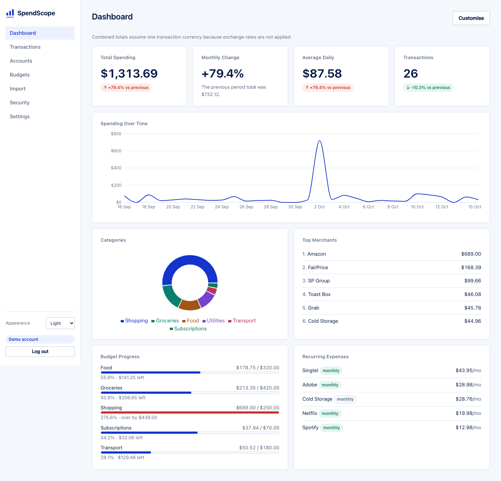
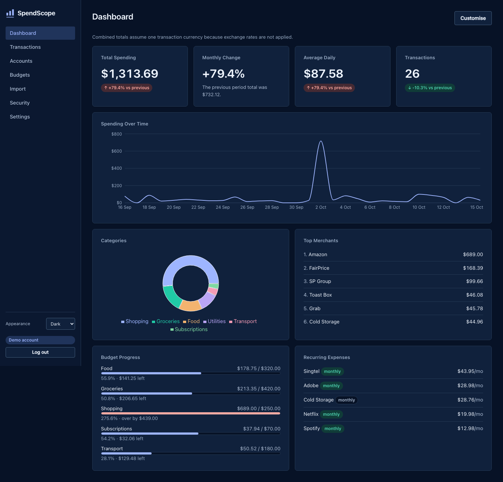
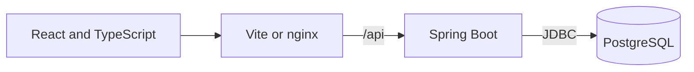

# SpendScope

SpendScope is a personal finance application that imports bank transactions,
categorises spending, and compares it with earlier periods and monthly budgets.
It combines a Java 21 and Spring Boot API with a React and TypeScript dashboard,
using PostgreSQL for persistence and aggregation.

The project explores the parts of a financial dashboard that require careful
reasoning: ownership checks, decimal arithmetic, duplicate detection, comparable
date ranges, and explanations for statistical findings. It does not connect to
banks or move money.

## Interface

The dashboard supports light, dark, and system appearance preferences. These
screenshots use synthetic demo data.

| Light appearance | Dark appearance |
|---|---|
|  |  |

The [code walkthrough](docs/learning-guide.md) explains how imports, queries,
security, and presentation fit together.

## Features

- Accounts support transaction history, filtering, search, and manual corrections.
  Accounts with transactions can be archived to preserve that history.
- CSV imports validate rows, apply ordered merchant rules, and report rejected
  rows and duplicates separately. The application retains parsed records and an
  import summary rather than a copy of the original statement.
- Analytics group outgoing spending by category, merchant, account, or time.
  Period comparisons distinguish calendar periods from rolling windows.
- Dashboard widgets save their layout and query settings to the user's account.
- Monthly category budgets calculate spending from transactions when requested.
- Recurring-payment detection estimates cadence and cost, while anomaly detection
  compares current spending with the same part of earlier months.
- Session authentication, CSRF checks, and ownership-scoped queries protect the
  API. Users can review their own security activity.

## Run locally

The development setup needs JDK 21, Maven, Node.js 22, and PostgreSQL 17. Docker
can provide the database or run the complete application.

### Docker

From the repository root:

```bash
cp .env.example .env
docker compose up --build
```

Open [localhost:8080](http://localhost:8080). Choose **Try the demo** to create a
disposable account containing synthetic transactions and budgets. Demo accounts
become eligible for automatic cleanup after 24 hours.

The Compose file is for local development: it uses HTTP and local database
credentials. `docker compose down` stops the stack while retaining the database
volume; adding `-v` also deletes that volume.

### Separate backend and frontend

Start the database from the repository root:

```bash
docker compose up -d db
```

Start the backend in one terminal:

```bash
cd backend
mvn spring-boot:run -Dspring-boot.run.profiles=local
```

Start the frontend in another terminal:

```bash
cd frontend
npm ci
npm run dev
```

Open [localhost:5173](http://localhost:5173). Vite proxies `/api` to the backend
at port 8080. The backend health endpoint is `/actuator/health`, and the local
OpenAPI UI is `/swagger-ui.html`.

The default database is `spendscope`, with username and password `spendscope`.
For an existing PostgreSQL installation, create that database and role or export
`DATABASE_URL`, `DATABASE_USERNAME`, and `DATABASE_PASSWORD` before starting
Maven. Docker Compose reads `.env`; a direct Maven invocation does not load it
automatically. Flyway applies the schema migrations on startup.

## Import sample data

Create an account in the application, then upload a file on the Import page.
The accepted CSV columns are:

```csv
date,description,amount
2026-08-01,STARBUCKS,-7.20
2026-08-02,GRAB,-14.50
2026-08-03,SALARY,3500.00
```

Negative amounts represent outgoings, and positive amounts represent inflows.
The import uses the selected account's currency. Files are limited to 5 MB and
10,000 data rows.

The `sample-data/` directory includes a normal statement, an overlapping
statement, and a file with invalid rows. Regenerate the synthetic data with:

```bash
python3 scripts/generate_sample_data.py
```

## Architecture



The backend is organised into domain packages such as `transaction`,
`importjob`, `analytics`, and `budget`. Controllers validate HTTP input, services
coordinate operations, and repositories implement persistence. The frontend
uses a shared API client and TanStack Query to cache responses and invalidate
affected views after mutations.

| Area | Implementation and reason |
|---|---|
| Money | Java `BigDecimal` and PostgreSQL `NUMERIC(19,4)` preserve decimal values during storage and aggregation. |
| Persistence | Flyway owns schema changes, while Hibernate validates entity mappings at startup. |
| Analytics | PostgreSQL calculates totals and time buckets, avoiding transfer of individual rows for dashboard aggregates. |
| Authentication | Server-side sessions support logout through invalidation; the browser sends a separate CSRF header for writes. |
| Frontend | React, strict TypeScript, TanStack Query, and Recharts support forms, cached queries, and charts. |
| Presentation | CSS custom properties support light, dark, and system appearance preferences. |
| Verification | JUnit, PostgreSQL integration tests, Vitest, and Playwright cover different boundaries of the application. |

The [architecture](docs/architecture.md) describes request and data flows, while
[engineering decisions](docs/decisions.md) records the tradeoffs.

## Verification

Run backend unit tests without a database:

```bash
cd backend
mvn test
```

Run the integration suite with a running Docker daemon:

```bash
mvn verify
```

Alternatively, point the integration suite at a **dedicated test database**:

```bash
export SPENDSCOPE_TEST_DB_URL=jdbc:postgresql://localhost:5432/spendscope_test
export SPENDSCOPE_TEST_DB_USERNAME=spendscope
export SPENDSCOPE_TEST_DB_PASSWORD=spendscope
mvn verify
```

The integration tests use PostgreSQL in both cases, so they exercise the native
queries, migrations, and constraints used by the application.

Run the frontend checks:

```bash
cd frontend
npm ci
npm run typecheck
npm run lint
npm run test
npm run build
```

With the backend available at port 8080, run browser tests:

```bash
npx playwright install chromium
npm run e2e
```

GitHub Actions defines backend, frontend, browser, Docker-build, and CodeQL
checks. Their results should be read from the relevant workflow run rather than
inferred from a fixed test-count badge.

## Deployment considerations

The supplied frontend expects `/api` on the same origin, as provided by nginx
in Compose. A public deployment needs HTTPS termination, trusted proxy
configuration, private database access, and deployment-specific credentials.
Activate the backend's `prod` profile to enable secure session cookies and
disable the OpenAPI endpoints.

CORS configuration alone does not make the current frontend work on a separate
API hostname: its relative API URL and CSRF cookie access would also need to
change. The repository provides deployment configuration, but that configuration
is not evidence of a verified public deployment. See [security](docs/security.md)
for the current controls and remaining operational requirements.

## Current limitations

- Cross-account totals do not convert currencies. Use a single currency when
  interpreting combined totals or budgets.
- Spending means the absolute sum of negative transactions. Positive refunds
  count as inflows and do not reduce the spending metric.
- CSV support uses the documented generic columns; bank-specific exports may
  need reformatting. Duplicate fingerprints can also collapse two legitimate
  purchases with identical account, date, description, amount, and currency.
- Merchant rules cover known patterns, and the statistical detectors can miss
  irregular payments or flag seasonal changes. Their outputs require review.
- Sessions and rate-limit counters are held in one backend process. Shared
  session storage and independent shared rate limiting are needed for multiple
  instances.
- Email verification, password recovery, multi-factor authentication, and
  user-facing data export or account deletion are not implemented.
- Imports run synchronously within the configured limits. Recurring detection
  loads a bounded date range into memory, and analytics have no result cache.

## Documentation

- [API reference](docs/api.md) describes endpoints and request examples.
- [Architecture](docs/architecture.md) explains the domain and data boundaries.
- [Engineering decisions](docs/decisions.md) compares the main implementation choices.
- [Security](docs/security.md) records controls and limitations.
- [Code walkthrough](docs/learning-guide.md) connects the implementation to the concepts it demonstrates.
- [Performance](docs/performance.md) describes the measurement method and its limits.

## License

SpendScope is available under the [MIT License](LICENSE).
