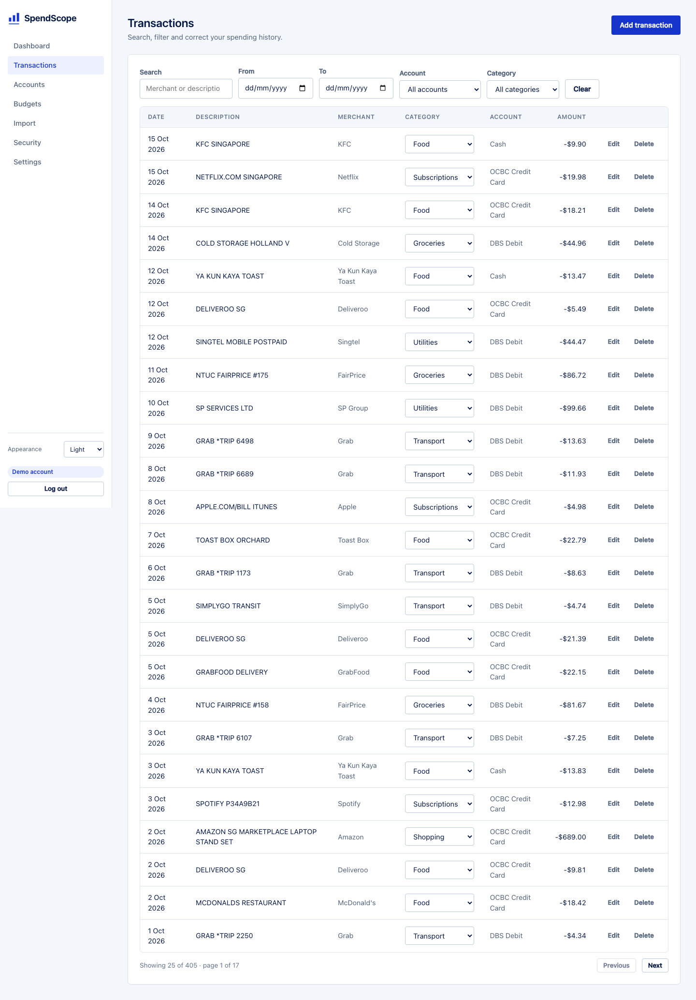
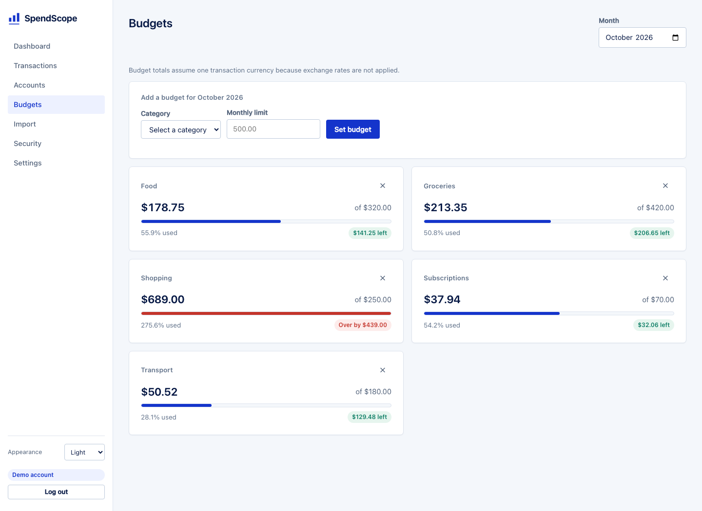
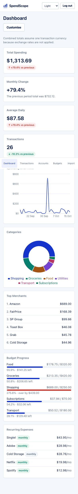
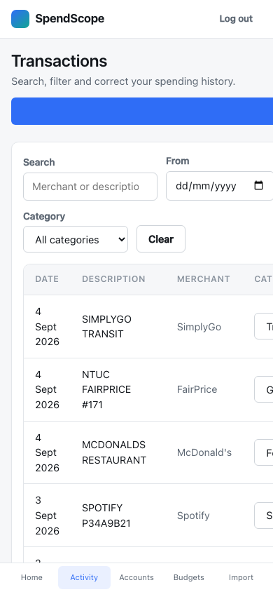

# SpendScope

**Personal finance analytics.** Import your bank transactions, let SpendScope
categorise them, and see where your money actually goes, with budgets,
subscription detection and unusual-spending alerts.

<p>
  
  
  
  
  
  
</p>

---

## Live demo

_Not yet deployed._ The application is deployment-ready (see
[Deployment](#deployment)) but no public instance is running.

Run it locally in about two minutes with [Docker](#docker), then click
**Try the demo** on the landing page. That creates a throwaway account with nine
months of synthetic data: no sign-up, no real financial information.

## Screenshots


*The dashboard, running on demo data. Metric cards with period comparison, a
30-day spending trend, a category breakdown, top merchants, budget progress
(Shopping is over its limit, in red) and detected subscriptions.*

| Transactions | Budgets |
|---|---|
|  |  |

| Mobile dashboard | Mobile transactions |
|---|---|
|  |  |

---

## Features

**Accounts and transactions**
- Multiple accounts (bank, credit card, cash) with per-account currency
- Full transaction CRUD with pagination, sorting, date/category/account filters
  and merchant search
- Accounts with history are **archived, not deleted**, so analytics survive

**CSV import**
- Upload a bank export; rows are validated, normalised, matched to merchants,
  categorised and de-duplicated before anything is saved
- One malformed row is reported with its line number; the valid rows around it
  still import
- **Raw statements are never stored.** Only the parsed transactions survive

**Automatic categorisation**
- Rule-based merchant matching over normalised descriptions
- ~50 merchants across 12 categories, configured in YAML rather than code
- Unknown merchants stay uncategorised rather than being guessed into a category

**Analytics**
- Total, average daily, transaction count, top category, top merchant
- Group by category, merchant, account, day, week or month
- Period comparison that handles partial months correctly: 1–6 September is
  compared against 1–6 August, not against the whole of August
- No `Infinity`, no `NaN`: an undefined percentage is `null` and renders as "—"

**Customisable dashboard**
- Add, remove, resize and configure widgets; the layout is saved to your account
- A widget is a saved analytics query, so new widget types need no backend change

**Budgets**
- Monthly limits per category with progress, remaining and exceeded status
- Spending is **always derived from transactions**, never stored, so it cannot
  drift

**Insights**
- Recurring-expense detection with cadence, monthly/annual cost, next expected
  date and a confidence grade
- Unusual-spending detection comparing month-to-date against the same slice of
  previous months

**Security**
- Session authentication, BCrypt, CSRF protection, per-user data isolation
- A security activity page showing your own logins and account changes

---

## Architecture

```
┌──────────────┐   HTTPS    ┌──────────────┐   HTTPS    ┌──────────────┐
│   Browser    │───────────▶│    nginx     │───────────▶│ Spring Boot  │
│ React + TS   │◀───────────│ static + /api│◀───────────│   monolith   │
└──────────────┘            └──────────────┘            └──────┬───────┘
                                                               │ TLS
                                                        ┌──────▼───────┐
                                                        │ PostgreSQL 17│
                                                        └──────────────┘
```

The backend is a **modular monolith** organised by domain, not by layer:

```
com.spendscope
├── auth  user  security          authentication and authorisation
├── account  category  transaction  the core domain
├── categorization  importjob     the CSV pipeline
├── analytics  dashboard  budget   metrics and presentation
├── recurring  anomaly            insights
└── audit  demo  common  config   supporting
```

Full diagrams and reasoning: **[docs/architecture.md](docs/architecture.md)**.

---

## Tech stack

| Layer | Choice | Why |
|---|---|---|
| **Backend** | Java 21, Spring Boot 3.5 | Mature security, persistence and testing; `BigDecimal` for money |
| **Persistence** | Spring Data JPA, Flyway | Versioned SQL migrations; `ddl-auto: validate` |
| **Database** | PostgreSQL 17 | `NUMERIC`, `date_trunc`, JSONB, partial unique indexes |
| **Frontend** | React 18, TypeScript (strict), Vite | Typed API contract, fast builds |
| **State** | TanStack Query | Server state in one place, never duplicated |
| **Charts** | Recharts | Composable SVG charts |
| **Styling** | Plain CSS with custom properties | Small design system, light/dark from one token block |
| **Testing** | JUnit 5, Testcontainers, Vitest, Playwright | Real PostgreSQL, real browser |
| **Infrastructure** | Docker, GitHub Actions | Multi-stage images, five-job CI |

Every one of these is justified, with its tradeoffs, in
**[docs/decisions.md](docs/decisions.md)**.

---

## Security

Full detail in **[docs/security.md](docs/security.md)**.

- **Per-user data isolation** enforced in the query, not after it. Every
  repository method is scoped by the authenticated user id, which comes from the
  session and never from a request parameter. Another user's row returns **404**,
  not 403, so ids cannot be enumerated.
- **Session cookies**, `HttpOnly` + `SameSite` + `Secure` in production, with the
  session id rotated on login to defeat fixation.
- **BCrypt** via a delegating encoder, so the algorithm can be upgraded later.
- **CSRF protection enabled**, using the double-submit cookie pattern.
- **CORS with exact origins**, never a wildcard.
- **Upload safety**: content validated (not the filename), size and row limits,
  sanitised filenames, and the raw file is never written to disk.
- **No information leakage**: errors never contain stack traces, SQL or exception
  names; audit metadata is filtered for anything credential-like.
- **Rate limiting** on login and on the anonymous demo endpoint.

The security tests are the point, not an afterthought: `CrossUserAccessIT`
alone asserts 23 cross-user scenarios.

---

## Local development

### Prerequisites

- JDK 21
- Node 20+
- PostgreSQL 17 (or Docker, to run just the database)

### 1. Database

```bash
# Option A: Docker
docker compose up -d db

# Option B: an existing PostgreSQL
createdb spendscope
psql -d postgres -c "CREATE ROLE spendscope LOGIN PASSWORD 'spendscope';"
psql -d postgres -c "ALTER DATABASE spendscope OWNER TO spendscope;"
```

### 2. Configuration

```bash
cp .env.example .env
```

The defaults work for local development. Flyway creates the schema on first
start, no manual SQL needed.

### 3. Backend

```bash
cd backend
mvn spring-boot:run -Dspring-boot.run.profiles=local
# → http://localhost:8080
# → http://localhost:8080/swagger-ui.html
# → http://localhost:8080/actuator/health
```

### 4. Frontend

```bash
cd frontend
npm install
npm run dev
# → http://localhost:5173
```

The dev server proxies `/api` to the backend, so the browser sees a single
origin and cookies behave exactly as they do in production.

---

## Docker

```bash
cp .env.example .env

# Just PostgreSQL (for running the backend from an IDE)
docker compose up -d db

# The whole stack
docker compose up --build
# → http://localhost:8080
```

nginx serves the frontend and proxies `/api` to the backend, so everything is on
one origin.

```bash
docker compose logs -f backend
docker compose down          # stop
docker compose down -v       # stop and delete the database volume
```

---

## Testing

```
345 tests: 192 backend unit · 129 backend integration · 21 frontend unit · 3 E2E
```

### Backend

```bash
cd backend

mvn test        # 192 unit tests, no database needed, ~4s
mvn verify      # + 129 integration tests against real PostgreSQL, ~25s
```

Integration tests use **Testcontainers**, which requires a running Docker
daemon. Without Docker, point them at an existing PostgreSQL instead:

```bash
createdb spendscope_test
export SPENDSCOPE_TEST_DB_URL=jdbc:postgresql://localhost:5432/spendscope_test
export SPENDSCOPE_TEST_DB_USERNAME=spendscope
export SPENDSCOPE_TEST_DB_PASSWORD=spendscope
mvn verify
```

The tests are identical either way; only the source of the connection differs.

> H2 is deliberately **not** used. Half of what these tests verify (`date_trunc`,
> JSONB, partial unique indexes) does not exist in it, and a suite that passes
> on H2 and fails in production is worse than no suite.

### Frontend

```bash
cd frontend
npm run typecheck
npm run lint
npm run test      # 21 unit tests
npm run build
```

### End-to-end

Needs the backend running on `:8080`.

```bash
cd frontend
npx playwright install chromium
npm run e2e
```

Drives a real browser through: register → create account → upload CSV → read the
dashboard → verify the spending total and category chart → log out → log back in.

---

## Sample data

```bash
python3 scripts/generate_sample_data.py
```

| File | Rows | Purpose |
|---|---|---|
| `sample-transactions.csv` | 396 | 9 months of realistic spending |
| `sample-transactions-overlap.csv` | 49 | Overlaps the above; demonstrates duplicate detection |
| `sample-transactions-with-errors.csv` | 6 | Deliberately broken rows; demonstrates per-row rejection |

To import: log in, create an account on **Accounts**, then upload on **Import**.

The data is shaped to exercise every feature: exact-amount monthly subscriptions
for recurring detection, a holiday two months back for period comparison, and an
unusually expensive current month so the anomaly card is populated.

For performance testing:

```bash
python3 scripts/generate_sample_data.py --performance   # 10,000 rows
```

---

## Demo mode

Click **Try the demo** on the landing page, or:

```bash
curl -X POST http://localhost:8080/api/demo/session
```

This creates a throwaway account with three accounts, ~400 transactions across
nine months, five budgets and the default dashboard, then logs you straight in.

The data is entirely synthetic and generated from a fixed seed, so every demo
account looks the same, so screenshots stay reproducible. Demo accounts are
flagged and reaped automatically after 24 hours.

---

## API

Full reference: **[docs/api.md](docs/api.md)**. Interactive docs at
`/swagger-ui.html` in development.

```
POST   /api/auth/register           POST   /api/imports/csv
POST   /api/auth/login              GET    /api/analytics/summary
POST   /api/auth/logout             POST   /api/analytics/query
GET    /api/auth/me                 GET    /api/dashboard/widgets
GET    /api/accounts                GET    /api/budgets
GET    /api/transactions            GET    /api/recurring
POST   /api/transactions            GET    /api/insights/anomalies
PUT    /api/transactions/{id}       GET    /api/security/events
DELETE /api/transactions/{id}       POST   /api/demo/session
```

---

## Project structure

```
spendscope/
├── backend/                 Spring Boot application
│   ├── src/main/java/com/spendscope/    domain packages
│   ├── src/main/resources/db/migration/ Flyway migrations (V1–V8)
│   ├── src/test/java/                   192 unit + 129 integration tests
│   └── Dockerfile
├── frontend/                React + TypeScript SPA
│   ├── src/api/             typed client (the only place fetch is called)
│   ├── src/hooks/           TanStack Query hooks, auth context
│   ├── src/components/      layout, shared UI, widget renderers
│   ├── src/pages/           one component per route
│   ├── e2e/                 Playwright specs
│   └── Dockerfile
├── docs/                    architecture · security · api · decisions
│                            learning-guide · performance
├── sample-data/             synthetic CSV files
├── scripts/                 data generation, performance measurement
├── .github/workflows/ci.yml five-job pipeline
└── docker-compose.yml
```

---

## Performance

Measured on 10,000 transactions. Full report and query plans:
**[docs/performance.md](docs/performance.md)**.

| Operation | Measured |
|---|---|
| CSV import, 10,000 rows | 1,193 ms |
| CSV re-import (all duplicates) | 406 ms |
| Transaction page (25 rows) | 35 ms |
| Deep paging (page 200) | 39 ms |
| Dashboard summary | 30 ms |
| Category aggregation, 1 year | 35 ms |
| Monthly aggregation, 3 years | 52 ms |
| Recurring detection, 12 months | 42 ms |

No query in the measured set falls back to a sequential scan. Every number was
observed on a real run; none is estimated.

---

## Engineering decisions

**[docs/decisions.md](docs/decisions.md)** documents 22 decisions with context,
alternatives, reasoning and tradeoffs. A sample:

- Why sessions instead of JWT
- Why `BigDecimal` and `NUMERIC(19,4)` instead of cents-as-long
- Why raw CSV files are never retained
- Why categorisation is rule-based rather than learned
- Why budget spending is derived rather than stored
- Why integration tests refuse to use H2

**[docs/learning-guide.md](docs/learning-guide.md)** explains the whole system
in 21 steps, from startup to deployment, for someone who knows Java but is new
to production Spring Boot.

---

## Known limitations

Stated plainly. These are boundaries of what was built, not defects in it.

**Security**
- Rate limiting and sessions are **in-process**; multi-instance deployment needs
  Spring Session (or sticky sessions) and a shared or edge rate limiter
- No email verification, password reset, or multi-factor authentication
- No account lockout or breach notification
- No user-facing data export or account deletion endpoint

**Functionality**
- **Multi-currency totals are summed without FX conversion.** Correct for
  single-currency users; wrong for genuinely multi-currency ones
- Only SpendScope's generic CSV format is supported, with no bank-specific parsers,
  no OFX/QIF, no bank APIs
- Analytics have no per-account filter; `ACCOUNT` grouping covers the question
  instead
- Categorisation does not generalise beyond its rule list
- Anomaly detection has no notion of seasonality: December will be flagged
  every year
- Dashboard reordering is by position, not drag-and-drop

**Operational**
- No caching layer; analytics are computed on every request
- CSV import runs synchronously in one transaction: fine at 10,000 rows, wrong
  at 500,000
- No metrics export (Prometheus/OTel) beyond the health endpoint
- **Docker images have not been built or run** in the environment this was
  developed in, since Docker was unavailable. The Dockerfiles and compose file are
  written and validated by inspection, and the CI pipeline builds them, but they
  are the one part of this project not verified by execution

---

## Future improvements

Roughly in order of value:

1. **Spring Session with JDBC**: survive restarts, scale horizontally, and get
   distributed rate limiting at the same time
2. **Password reset and email verification**
3. **Bank-specific CSV profiles**: column mapping per bank, so users stop
   reformatting exports by hand
4. **Multi-currency support** with stored FX rates
5. **Learned categorisation** trained on users' own corrections (the manual
   overrides are exactly the labelled data the rules cannot produce)
6. **Asynchronous imports** for large files, with progress reporting
7. **Recurring-payment alerts**: "Spotify went up by 2.00 this month"
8. **Data export** (CSV and JSON) and account deletion, for GDPR
9. **Drag-and-drop dashboard** reordering
10. **Metrics export** and distributed tracing

---

## License

MIT
