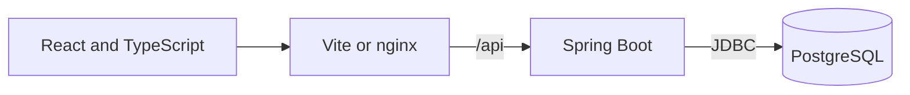
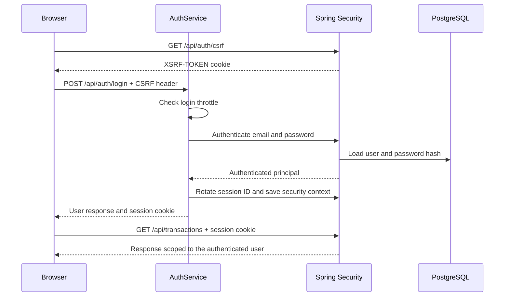
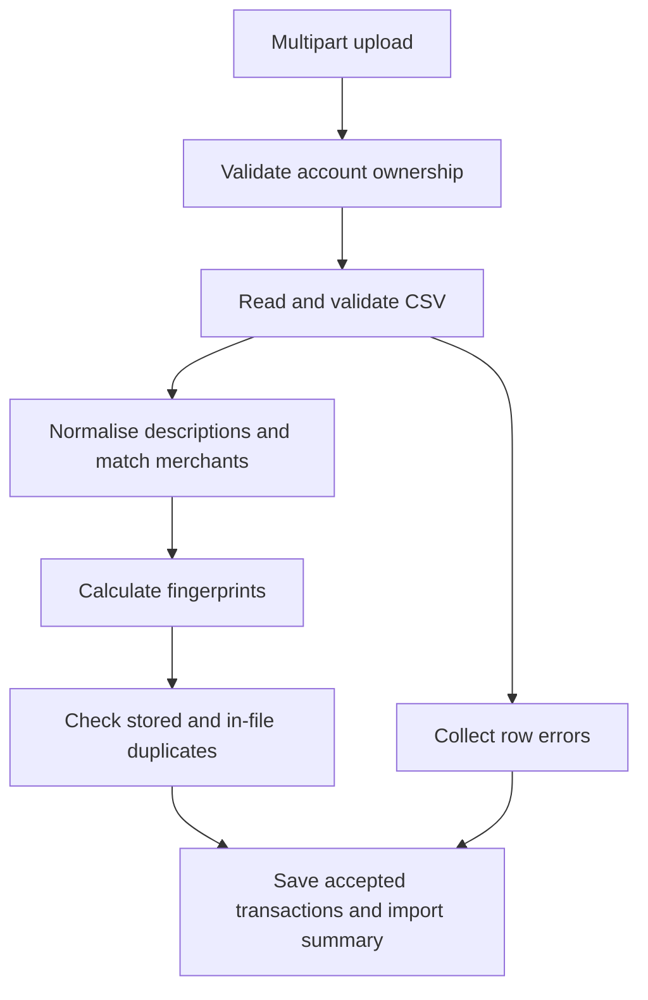
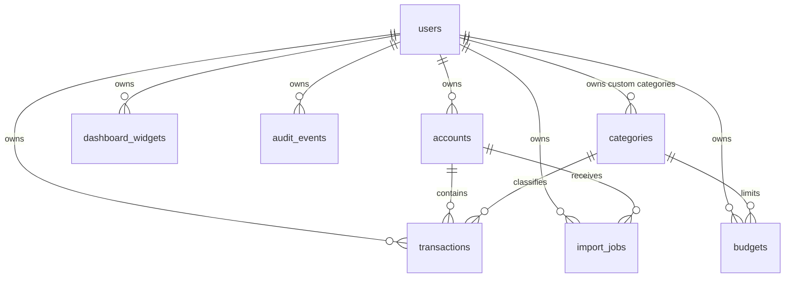

# Architecture

SpendScope has one Spring Boot backend, a static React frontend, and a PostgreSQL
database. The supplied development and Compose setups expose the API through
the frontend's origin, which keeps session cookies and CSRF token access within
the same browser origin.



Compose uses HTTP locally. HTTPS termination and database transport encryption
are deployment responsibilities; neither is provided by this diagram or enabled
by the local Compose file.

## Domain structure

The backend packages group related controllers, services, repositories,
entities, and request/response records by domain:

```
com.spendscope
├── auth, user, security          authentication and access control
├── account, category, transaction
├── categorization, importjob    merchant matching and CSV processing
├── analytics, dashboard, budget
├── recurring, anomaly           statistical insights
└── audit, demo, common, config
```

This structure keeps the application deployable as one unit while making
related code easy to find. It does not enforce isolated modules: some services
use repositories from other packages, including analytics queries over
transactions and accounts. Extracting a service would require an explicit
interface and data ownership review.

Within a typical domain, controllers validate input and obtain the authenticated
principal. Services enforce ownership and business rules within transaction
boundaries. Repositories execute queries, and response records expose selected
fields rather than serialising JPA entities.

## Authentication and ownership



Authentication establishes who made the request; authorisation determines which
records that person can access. Resource lookups therefore combine the resource
ID with the user ID obtained from the authenticated principal:

```java
transactionRepository.findByIdAndUserId(transactionId, authenticatedUserId);
```

The same ownership check applies when attaching a transaction to an account or
category. Unknown IDs and inaccessible private records return 404. Built-in
categories are a separate shared case: users may read them but cannot edit them.
`CrossUserAccessIT` exercises these boundaries through the HTTP API.

## CSV import



The service checks account ownership before reading the upload content. The web
server has already received the multipart request at that point. The parser
checks encoding, required columns, dates, and amounts; a bad data row is reported
without discarding the other valid rows. Structural file errors reject the
request. The accepted rows and import summary share a database transaction.

Fingerprints use the following fields:

```
SHA-256(userId | accountId | date | normalisedDescription | amount | currency)
```

Normalisation makes cosmetic description differences less likely to prevent a
match, and a fixed decimal scale gives `7.2` and `7.2000` the same representation.
Stored fingerprints are queried in chunks, while a set handles repetitions in
the current file. This avoids a lookup for each CSV row.

The fingerprint index is non-unique because manual entry may represent two
identical purchases. Import duplicate detection is consequently a heuristic:
it can skip legitimate identical purchases, and concurrent imports are not
serialised by a uniqueness constraint. Existing rows are not overwritten.

Only parsed transactions and import metadata are retained by the application.
The servlet container may use temporary files while receiving multipart uploads;
this is different from retaining a statement as application data.

## Analytics and dashboard configuration

`PeriodResolver` turns named periods into inclusive date ranges. `AnalyticsService`
uses database aggregates for totals and groupings, then maps query results into
response records. Average daily spending includes quiet days in the denominator,
and time series insert zero-valued buckets where no outgoing transactions exist.

Spending is the positive magnitude of negative amounts. Positive entries,
including refunds, contribute to income and net flow rather than reducing the
spending metric. Percentages with a zero baseline are `null`, because a relative
change from zero has no finite value.

Calendar comparisons use the corresponding part of the previous month or year;
completed months compare with complete previous months. Rolling and custom
ranges compare with the immediately preceding range of equal length. An
injected `Clock` makes month boundaries and leap years reproducible in tests.

Most widgets store a metric, period, grouping, and presentation settings, which
the frontend turns into a request to `/api/analytics/query`. Budgets, recurring
payments, anomalies, and recent transactions use their own endpoints. Existing
widget types can be configured without adding endpoints, but a new metric or
widget type can still require backend enums, validation, and frontend rendering.

## Persistence

Flyway migrations create the schema, and Hibernate validates entity mappings
at startup. The principal relationships are:



Amounts use `NUMERIC(19,4)`. Ownership is stored as a user ID, and the secondary
transaction indexes begin with that ID to support user-scoped reads. Shared
categories have a null owner; partial unique indexes enforce name uniqueness
separately for shared and user-owned categories.

Deleting a custom category clears transaction references without deleting the
transactions. Accounts with transaction history must be archived. User deletion
cascades through owned data, which supports demo cleanup, although there is no
user-facing account deletion endpoint.

## Frontend state and deployment

`api/client.ts` sends requests, reads the CSRF token, and maps API failures to a
typed error. TypeScript describes the expected response shape; it does not
validate network responses at runtime. TanStack Query caches server responses,
and mutation hooks invalidate the affected transaction, analytics, and budget
queries. Local component state handles form drafts and presentation choices.

Route protection improves navigation, while backend ownership checks enforce
access. The frontend uses a relative `/api` URL and reads its CSRF cookie from
`document.cookie`, so the supported deployment keeps frontend and API on the
same origin. A separate API hostname requires changes beyond CORS settings.

The `prod` profile enables secure session cookies, disables OpenAPI, and accepts
forwarded headers. An HTTPS proxy must strip untrusted forwarded headers, and
the backend should be reachable only through that trusted proxy. Database
credentials, TLS, backups, and shared session storage need deployment-specific
configuration. See [security.md](security.md) for the current limitations.
