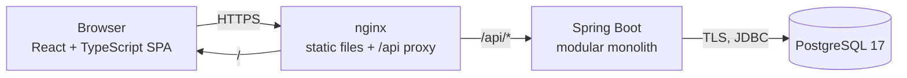
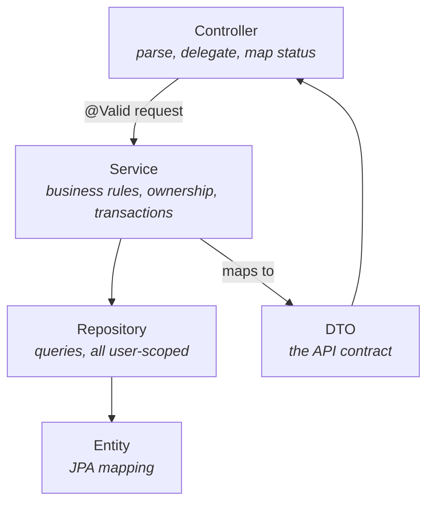
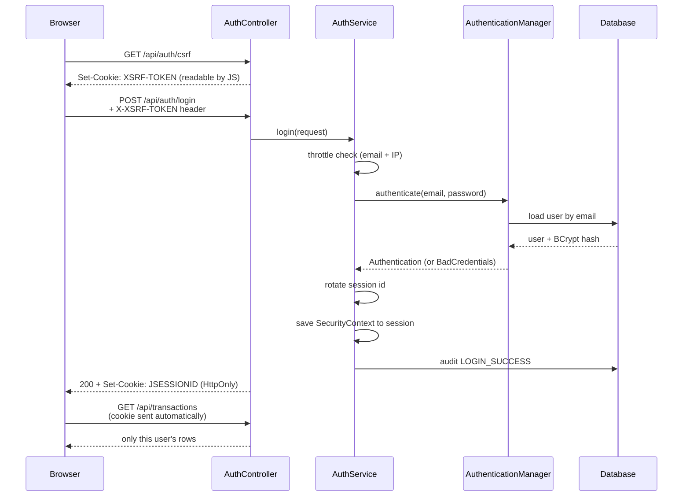
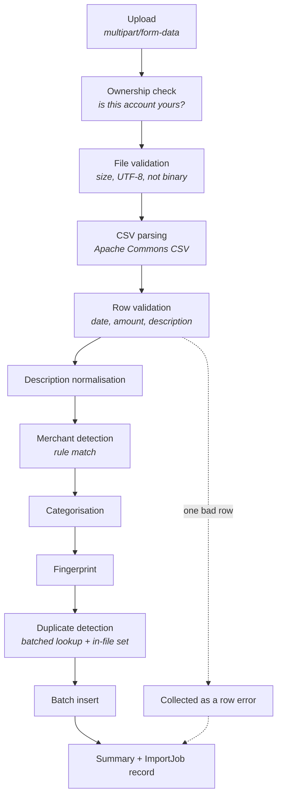
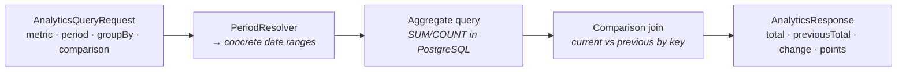
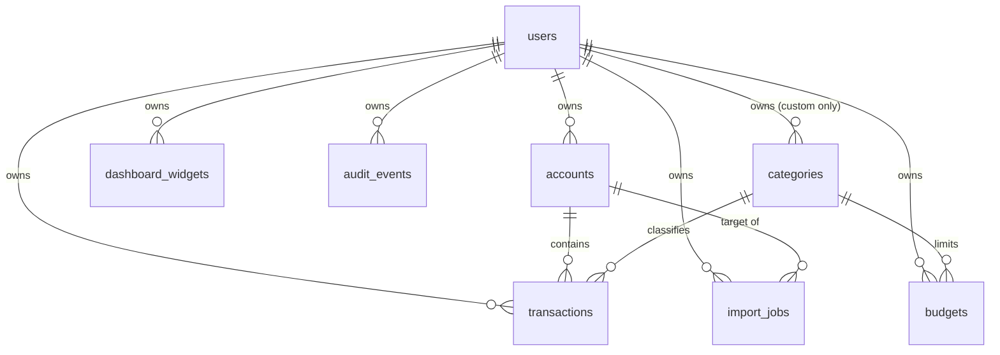
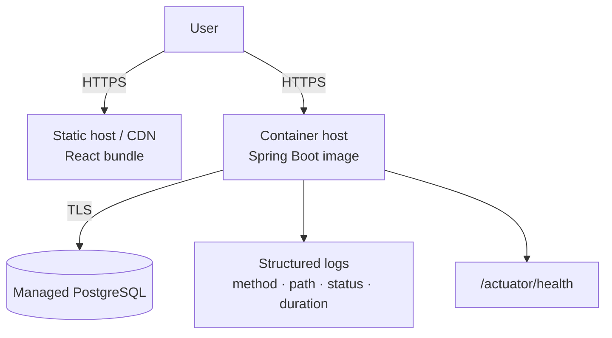

# Architecture

## Shape of the system



One deployable backend, one static frontend bundle, one database. The frontend
is served by nginx, which also proxies `/api` to the backend so that the browser
only ever talks to a single origin — that is what keeps the session cookie
simple (no cross-site cookie rules, no CORS preflight on every request).

A split-origin deployment — static frontend on a CDN, API on its own hostname —
is also supported, and is why CORS is configured properly rather than disabled.
See [security.md](security.md).

## Backend: a modular monolith

The backend is organised by **domain**, not by technical layer. There is no
top-level `controllers/`, `services/`, `repositories/` split; each domain owns
its own controller, service, repository, entity and DTOs.

```
com.spendscope
├── auth            registration, login, logout, password change
├── user            the User entity and its lookups
├── security        Spring Security config, principal, CSRF, login throttle
├── account         bank accounts, cards, cash
├── category        built-in and custom categories
├── categorization  description normalisation, merchant rules
├── transaction     the core entity, CRUD, filtering, fingerprinting
├── importjob       the CSV pipeline
├── analytics       metrics, periods, grouping, comparison
├── dashboard       configurable widgets
├── budget          monthly limits and derived progress
├── recurring       subscription detection
├── anomaly         unusual-spending detection
├── audit           the security activity trail
├── demo            the throwaway demo environment
├── common          errors, validation, money, paging
└── config          clock, OpenAPI
```

### Why a monolith

At this size, microservices would add network calls, partial-failure handling,
distributed tracing and deployment coordination in exchange for nothing. The
whole application starts in about 2.5 seconds and is one artifact to deploy.

The modularity that matters is *internal*: domains talk to each other through
services, never by reaching into another domain's repository. `TransactionService`
asks `AccountService.require(userId, accountId)` for an account; it does not
query `AccountRepository` itself. If a domain ever genuinely needs to be
extracted, that boundary is already the seam.

### Layering inside a domain



Rules that hold everywhere:

- **Controllers are thin.** They extract the principal, call one service method
  and map the result to a status code. No business logic, no queries.
- **Entities never leave the service layer.** Every response is a DTO record.
  This is what structurally guarantees a password hash cannot be serialised.
- **Services own transactions.** `@Transactional` lives on service methods, so a
  unit of work is a business operation, not an HTTP request.
- **Repositories are user-scoped.** See the authorisation model below.

## Authentication flow



The order inside `login` is deliberate: throttle, authenticate, **rotate the
session id**, then save the context. Rotating before saving is what defeats
session fixation.

## Authorisation model

There are no roles. Every user is the same kind of user, and authorisation is
entirely about **data ownership**.

The rule is enforced in the query, not after it:

```java
// Not this. The row is loaded before anyone checks who owns it, and a
// forgotten check leaks it.
transactionRepository.findById(id);

// This. The user id is part of the WHERE clause, so another user's row is
// never loaded into memory at all.
transactionRepository.findByIdAndUserId(id, authenticatedUserId);
```

Three properties make this hold in practice:

1. **The user id comes from the session**, read off the authenticated principal —
   never from a path variable, query parameter or request body.
2. **Every service method takes `userId` as its first argument.** An unscoped
   call is visibly wrong at the call site rather than something a reviewer has
   to notice by absence.
3. **A missing row and someone else's row both return 404.** Returning 403 for
   "exists but is not yours" would let an attacker enumerate valid ids.

`CrossUserAccessIT` asserts this endpoint by endpoint, including that Bob cannot
attach his transaction to Alice's account or import a CSV into it.

## CSV import pipeline



Two design points worth calling out:

- **The ownership check happens before the file is read.** No work is done on a
  file destined for someone else's account.
- **A bad row is a bad row, not a bad file.** Row-level failures are collected
  and reported with line numbers; the valid rows around them still import.

The whole import runs in one transaction: either the accepted rows and the job
record are both written, or neither is.

### Duplicate detection

Bank statements have no stable transaction id, so identity is derived:

```
SHA-256( userId | accountId | date | normalisedDescription | amount | currency )
```

The normalised description is used so cosmetic differences between two exports
of the same row produce the same fingerprint. The amount is scaled first, so
`7.2` and `7.2000` agree.

The column is indexed but **not unique**: buying the same coffee twice on one
day is legitimate. Duplicates are reported, never silently dropped or
overwritten.

## Analytics pipeline



All aggregation happens **in the database**. Pulling a year of transactions into
the JVM to sum them works at a thousand rows and falls over at a hundred
thousand.

A widget is a saved analytics request. That is why the dashboard is
configurable without any new backend code: adding a widget type is a row in
`dashboard_widgets`, not an endpoint.

### The period comparison rule

The obvious implementation is wrong. On 5 September, "this month" covers five
days; comparing it against the whole of August would report a ~90% drop in
spending on the 5th of every month, forever.

- **Calendar periods** (this month, last month, this year) compare against *the
  same slice* of the preceding calendar period: 1–5 September against
  1–5 August.
- **Rolling windows** (last 30/90 days, custom) compare against the equally long
  window immediately before them.

A percentage change is `null` — never `Infinity`, never `NaN` — whenever the
previous total is zero or absent. The API documents `null` as "no comparison
available", and the UI renders it as an em dash rather than as `0%`, which would
falsely claim spending was flat.

## Database

Eight tables, created by eight Flyway migrations.



Notes on the shape:

- **`categories.user_id` is nullable.** `NULL` means one of the twelve built-in
  categories, shared by every user and editable by none. Two partial unique
  indexes enforce uniqueness separately for built-ins and for each user's custom
  set, because a plain `UNIQUE(user_id, name)` would not de-duplicate built-ins
  (`NULL` never equals `NULL` in SQL).
- **Money is `NUMERIC(19,4)`**, never `float` or `double`.
- **`user_id` is a plain column**, not a `@ManyToOne`. Nothing navigates from a
  transaction to a user object, and a raw id keeps every ownership-scoped query
  a single-table lookup with no join and no lazy-loading surprise.
- **Amounts are signed.** Negative is money out. A period total is a plain `SUM`,
  and a refund correctly cancels the purchase it reverses.
- **`ON DELETE CASCADE` from `users`** — deleting a user removes everything they
  own, which is what makes demo-account cleanup a one-line delete.
- **`ON DELETE SET NULL` from `categories`** — deleting a category must not
  delete the transactions filed under it.

Every index on `transactions` leads with `user_id`, because no query ever
crosses users.

## Frontend

```
src/
├── api/          typed client + endpoint list (the only place fetch is called)
├── hooks/        TanStack Query hooks, auth context
├── components/   layout, shared UI, widget renderers
├── pages/        one component per route
├── lib/          formatting
└── styles/       design tokens + component classes
```

- **Server state lives in TanStack Query and nowhere else.** No component copies
  API data into `useState`. That duplication is what makes UIs go stale.
- **Auth state is derived from the server.** There is no `isLoggedIn` boolean;
  the source of truth is `GET /api/auth/me`.
- **One `fetch` wrapper.** It attaches the CSRF header, sends credentials, turns
  non-2xx into a typed `ApiError` and notifies the app when a session expires.
- **Route protection is UX only.** Anyone can edit the JavaScript running in
  their own browser. The real boundary is the backend.

## Deployment



Production configuration is entirely environment variables: database URL and
credentials, allowed frontend origin, secure-cookie flag, active profile. No
secret is committed. Flyway runs on startup; `ddl-auto` is `validate`, so a
mismatched schema fails fast at boot rather than corrupting data at runtime.

See the README for exact deployment steps.
